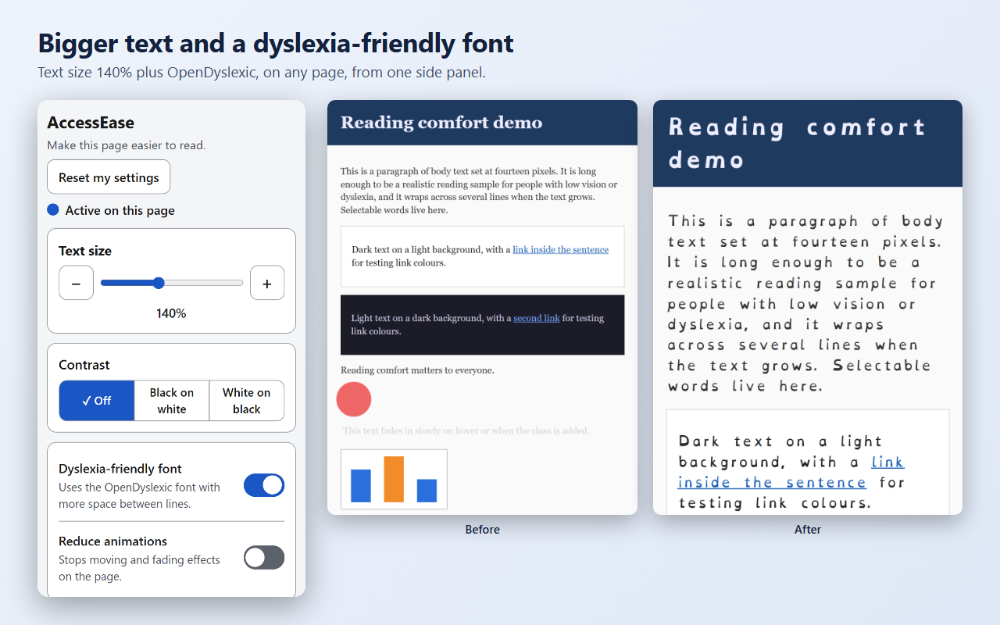
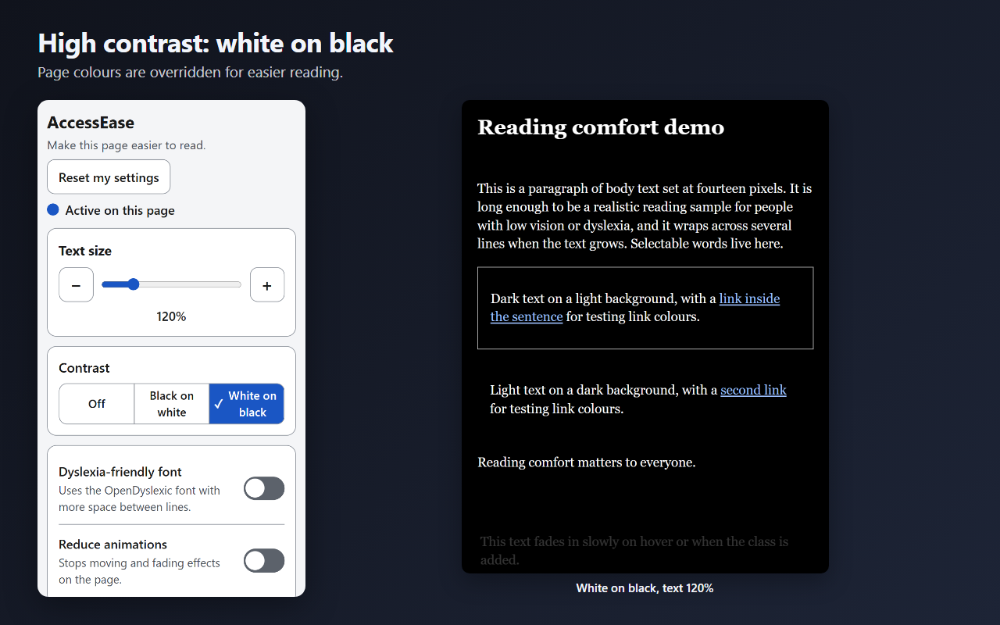
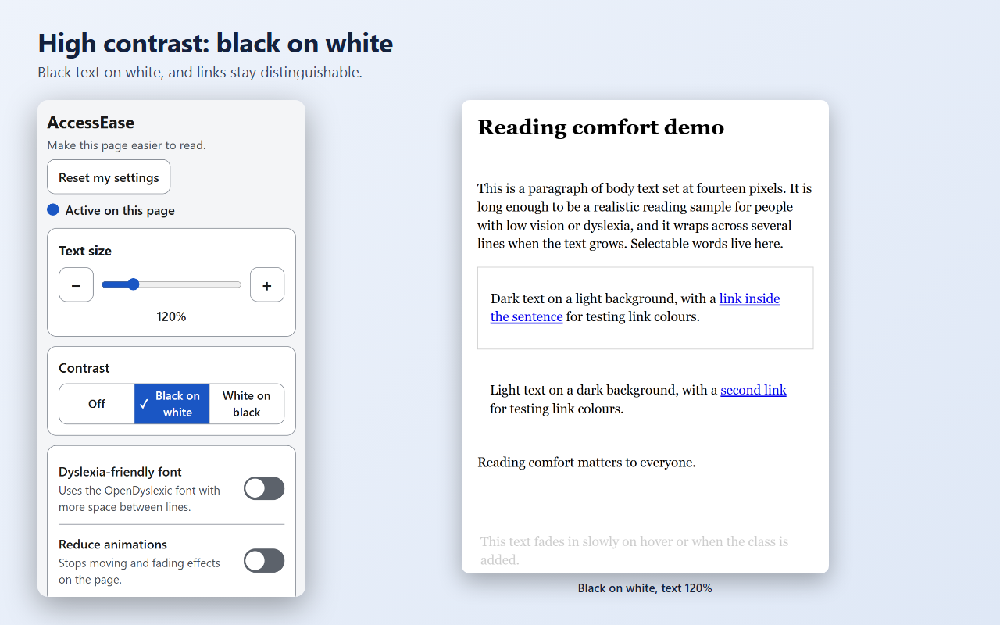
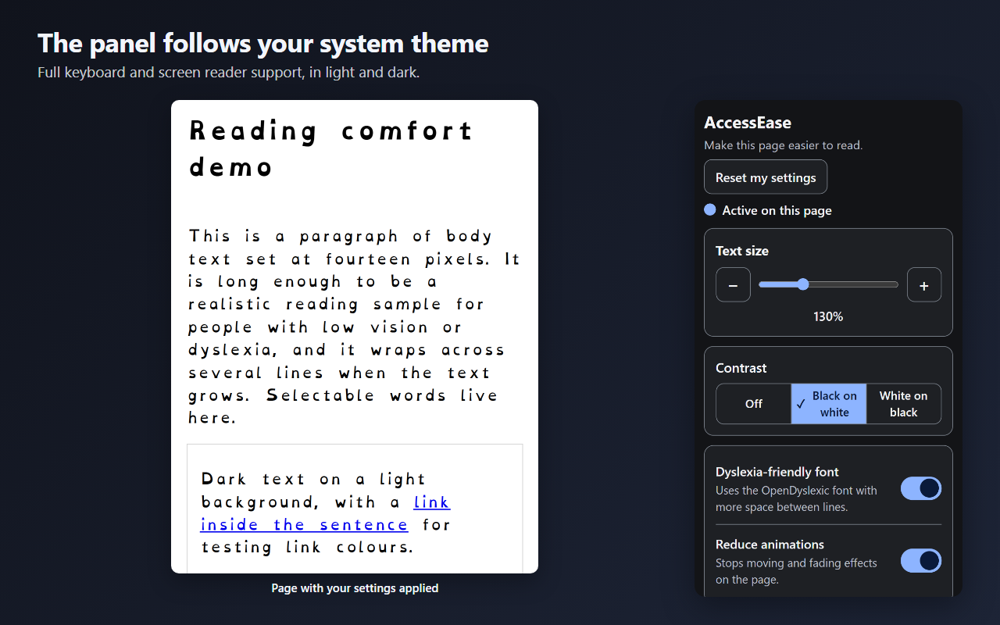

# AccessEase

[](https://github.com/vincentwesley/access-ease/actions/workflows/ci.yml)
[](LICENSE)

**Make any web page easier to read: bigger text, high contrast, a dyslexia-friendly font and calmer motion.**

AccessEase is a Chrome side panel. No account, no backend, no telemetry.

## Screenshots









## Features

- **Text size:** 100% to 200% in 10% steps, with a live percentage. Plain text in `div`/`span`/link elements sized in pixels is scaled too (conservatively).
- **Pause on this site:** turn AccessEase off for one website only, and resume it from the panel. The list of paused sites is stored locally.
- **High contrast:** off, black on white, or white on black. Photos and videos are left untouched.
- **Dyslexia-friendly font:** bundled OpenDyslexic with slightly more word and line spacing.
- **Reduce animations:** stops animations, transitions and smooth scrolling.
- **Reset my settings:** one button returns the page to normal.
- **Apply on all sites (optional):** grant access once and your settings apply automatically to every page you visit.
- **Accessible panel:** fully keyboard and screen-reader operable; follows your system light or dark theme.
- **Private:** settings stay on your device. Nothing is sent anywhere.

Not included: accounts or sync, per-site profiles, colour-blind filters, translation, and read-aloud (text-to-speech).

## Install

### From the Chrome Web Store

Coming soon. This page will link to the listing once it is published.

### Install unpacked (works today)

1. Get the code: download the latest zip from the [Releases](https://github.com/vincentwesley/access-ease/releases) page and unzip it, or clone this repository.
2. Open `chrome://extensions` in Chrome (114 or newer).
3. Turn on **Developer mode** (top right).
4. Click **Load unpacked** and pick the extension folder (the folder that contains `manifest.json`; in a clone this is `extension/`).
5. Click the puzzle-piece icon in the toolbar and pin AccessEase.
6. Click the AccessEase icon to open the side panel.

## How to use (30 seconds)

1. Open any normal web page and click the AccessEase icon. The side panel opens.
2. Drag the **Text size** slider, pick a **Contrast** option, and switch on **Dyslexia-friendly font** or **Reduce animations**. The page changes immediately.
3. Want it everywhere? Turn on **Apply on all sites** and approve Chrome's prompt. Without it, AccessEase works on the tab where you clicked the icon.
4. Press **Reset my settings** to undo the page changes.

## Permissions

| Permission | Why it is needed |
|---|---|
| `storage` | Saves your settings locally in `chrome.storage.local`. |
| `activeTab` | Temporary access to the current tab only after you click the toolbar icon. This is why installing shows no "read all your data" warning. |
| `scripting` | Adds and removes the style sheet that changes how the page looks on that tab. |
| `sidePanel` | Shows the AccessEase interface in Chrome's side panel. |
| Optional host access (all sites) | Not requested at install. Asked only if you turn on **Apply on all sites**, so a small script can apply your settings automatically on each page. Turn the setting off and it is released. |

**Why `web_accessible_resources` with `use_dynamic_url`?** The page has to be able to load the bundled OpenDyslexic font files, and the all-sites script loads three of the extension's own modules (`lib/settings.js`, `lib/css.js`, `lib/inject.js`). Those files are therefore exposed to web pages. `use_dynamic_url: true` makes their URLs contain a per-session id instead of the fixed extension id, so a website cannot fetch the extension's files by a fixed id to detect that AccessEase is installed. It does not make AccessEase invisible: on a page that is being styled, a site that looks can still see the dynamic font URL and the style element.

No `tabs`, `history`, `webRequest` or static host permissions.

## Privacy

AccessEase collects no data and makes no network requests. Your settings are stored only in your browser and are removed when you uninstall. Page content is never read out or sent anywhere; the extension only changes how a page looks. See [PRIVACY.md](PRIVACY.md).

## Limitations

- It cannot change `chrome://` pages, the Chrome Web Store, or other pages Chrome protects from extensions. The panel tells you when a page is off limits.
- Without "Apply on all sites", access is per tab: it covers the tab where you clicked the icon and lasts until you navigate away. Open the panel again after navigating, or turn on all sites.
- Sites with unusual CSS may not respond perfectly. Text size on sites that fix sizes in pixels is approximate, and some custom-drawn or canvas content cannot be restyled.
- Evidence that dyslexia-oriented fonts improve reading is mixed. AccessEase offers the font as an option some people find comfortable and makes no medical or therapeutic claim.

## Development

Requires Node 20 or newer. The extension itself has no runtime dependencies and no build step to run; load the `extension/` folder unpacked.

```
npm ci
npm test            # unit tests
npm run lint
npm run build       # writes the release zip to dist/
npm run test:e2e    # real-browser tests with Playwright's Chromium
```

See [CONTRIBUTING.md](CONTRIBUTING.md), [SPEC.md](SPEC.md) and [DECISIONS.md](DECISIONS.md).

## Credits and license

- Bundled font: [OpenDyslexic](https://github.com/antijingoist/opendyslexic), licensed under the SIL Open Font License 1.1 (see `extension/fonts/OFL.txt`). It is redistributed unmodified. See [THIRD_PARTY_NOTICES.md](THIRD_PARTY_NOTICES.md).
- AccessEase is an original work, not a fork of any other project.

The code is released under the [MIT License](LICENSE).

Provided as is, without warranty of any kind.
